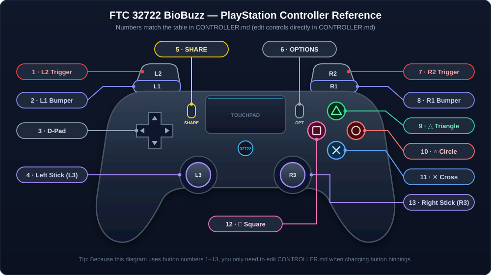

# Controller Map — FTC 32722 BioBuzz

Controls implemented in [`DriverControlled.java`](TeamCode/src/main/java/org/firstinspires/ftc/teamcode/opmodes/teleop/DriverControlled.java) and [`RobotMonitor.java`](TeamCode/src/main/java/org/firstinspires/ftc/teamcode/robot/debug/RobotMonitor.java).

> **How to edit this diagram & table easily:**
> 1. Edit any button's title, subtitle, category color, or notes in [`doc/controller-map.json`](doc/controller-map.json).
> 2. Run `python doc/generate_controller.py` to regenerate both [`doc/media/controller.svg`](doc/media/controller.svg) and this `CONTROLLER.md`.

---

## PlayStation Button Reference

| PlayStation Control | FTC SDK Field | Action | Notes |
| --- | --- | --- | --- |
| **L2 Trigger** | `gamepad.left_trigger` | Global Emergency Stop (with R2) | Pull both L2 + R2 >85% for 150 ms (gamepad1 or gamepad2, all OpModes) |
| **R2 Trigger** | `gamepad.right_trigger` | Global Emergency Stop (with L2) | Latches all subsystems to 0 power until SHARE is held 0.5 s |
| **L1 Bumper** | `gamepad.left_bumper` | Slow Drive Speed (50%) | Sets speedMultiplier = RobotConstants.SLOW_SPEED_MULTIPLIER |
| **R1 Bumper** | `gamepad.right_bumper` | Fast Drive Speed (100%) | Sets speedMultiplier = RobotConstants.FAST_SPEED_MULTIPLIER |
| **SHARE / CREATE** | `gamepad.back` | Clear / Reset All E-Stops | Hold for 500 ms on gamepad1 or gamepad2 to release E-Stop latches |
| **OPTIONS** | `gamepad.start` | Reserved by FTC Driver Station | OPTIONS + Cross/Circle binds Gamepad 1 / Gamepad 2 |
| **Left Stick (L3 axis)** | `left_stick_x / left_stick_y` | Mecanum: Forward/Strafe &#124; Tank: Left Drive | 5% deadzone applied (RobotConstants.GAMEPAD_DEADZONE) |
| **Right Stick (R3 axis)** | `right_stick_x / right_stick_y` | Mecanum: Turn (X) &#124; Tank: Right Drive (Y) | 5% deadzone applied (RobotConstants.GAMEPAD_DEADZONE) |
| **D-Pad (Up/Down/Left/Right)** | `gamepad.dpad_*` | Unassigned | Edit doc/controller-map.json when assigned |
| **△ Triangle** | `gamepad.y` | Intake Reverse (Jam Clear) | Runs a 200 ms reverse pulse via intake.triggerReverse() |
| **○ Circle** | `gamepad.b` | Reset Odometry Pose to (0, 0, 0°) | Active when RobotConstants.MECANUM_ODO_INSTALLED is true |
| **✕ Cross** | `gamepad.a` | Toggle FlyWheel On / Off | If FlyWheel Auto E-Stop is active, 1st press clears latch safely |
| **□ Square** | `gamepad.x` | Toggle Intake Enabled / Disabled | If Intake Auto E-Stop is active, 1st press clears latch safely |

---

## Emergency Stop & Auto E-Stop Details

- **Global E-Stop (`L2 + R2`)**: Pull both triggers past `85%` for `150 ms` on `gamepad1` or `gamepad2` (active in **all** OpModes). Cuts power to DriveTrain, FlyWheel, and Intake and latches until cleared.
- **Clear E-Stops (`SHARE`)**: Hold `SHARE` (`gamepad.back`) for `500 ms` on either gamepad to release global and subsystem E-Stop latches.
- **FlyWheel Auto E-Stop**: Locks FlyWheel on `STALLED`, `ENCODER_FAULT`, or `OVERCURRENT`. Press **`✕` Cross** once to clear the latch safely (stays off), then press **`✕`** again to restart.
- **Intake Auto E-Stop**: Locks Intake if jam recovery (`REVERSE` → `SUPER`) fails, or on `ENCODER_FAULT` / `OVERCURRENT`. Press **`□` Square** once to clear the latch safely (stays off), then press **`□`** again to re-enable.
- **DriveTrain Auto E-Stop**: Locks DriveTrain on sustained `OVERCURRENT` (`AUTO_ESTOP_DRIVETRAIN_ON_OVERCURRENT = true` in [`RobotConstants.java`](TeamCode/src/main/java/org/firstinspires/ftc/teamcode/config/RobotConstants.java)). Hold **`SHARE`** for `0.5 s` to clear.

---

## Drive Mode Switch (`MECANUM_ODO_INSTALLED`)

Configured in [`RobotConstants.java`](TeamCode/src/main/java/org/firstinspires/ftc/teamcode/config/RobotConstants.java):
- `MECANUM_ODO_INSTALLED = true`: Left Stick = Forward/Backward (`Y`) + Strafe (`X`), Right Stick = Turn (`X`), **`○` Circle** = Reset Odometry Pose `(0, 0, 0°)`.
- `MECANUM_ODO_INSTALLED = false`: Legacy Tank Drive (Left Stick `Y` = Left motors, Right Stick `Y` = Right motors).
